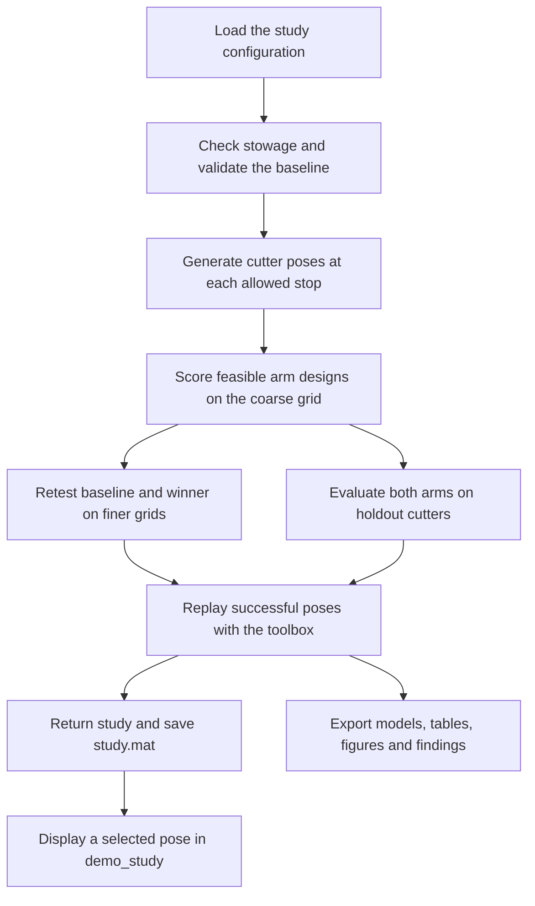
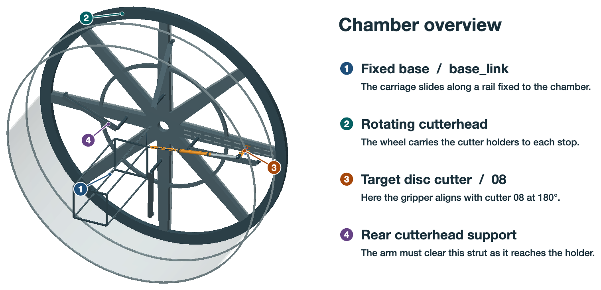
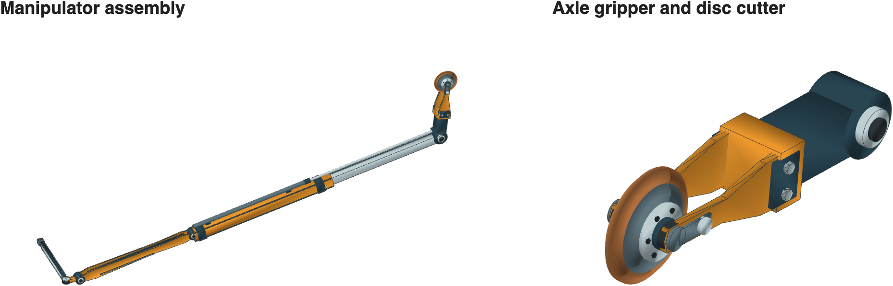

# CutterReach

**Workspace Accessibility Analysis & Design Improvement of a Cutter-Changing Manipulator in a Confined Tunnel Boring Machine Chamber**

[Simplified Chinese guide](docs/README.zh-CN.md)

The disc cutters on a tunnel boring machine (TBM) wear as they break rock. Replacing a worn cutter puts workers in the confined chamber behind the cutterhead. A robotic gripper working from that chamber has to reach the holder at the correct angle, with enough room for the shoulder, elbow and forearm to clear the surrounding structure.

CutterReach evaluates the four-revolute, two-prismatic (4R2P) arm described by Yang et al. For each cutter, the model turns the cutterhead in 5° steps and tests the arm at each stop. A cutter counts once if at least one stop admits a pose that meets the tool center point (TCP) position and gripper orientation tolerances, respects the joint limits and passes the collision checks.

**Default result.** For the assumed layout of 10 cutters on one spoke, increasing the upper-arm length from 0.732 to 0.900 m and the telescope stroke from 0.650 to 0.875 m raises coverage from **3/10 to 5/10**, adding cutters **08 and 09**. Each design already reaches all its accessible cutters at mechanical zero, so the two gains come from the arm dimensions. These results verify static service poses with the cutterhead stopped. The approach, cutter removal, reinstallation and withdrawal paths still require validation. [Per-cutter findings](results/findings.md) · [Design comparison data](results/performance.csv)

[MATLAB setup](#matlab-setup-and-execution) · [Program workflow](#program-workflow-and-code-map) · [Design rationale](#design-objectives-and-structural-trade-offs) · [Mechanical model](#manipulator-and-chamber-model) · [Accessibility analysis](#cutter-accessibility-analysis) · [Results](#design-comparison) · [Parameters](#parameter-guide) · [Experiments](#parameter-studies)

## MATLAB setup and execution

Download and extract the repository ZIP, or run `git clone https://github.com/Errorsteved/CutterReach.git` in a terminal. Set the MATLAB **Current Folder** to the directory containing `run_study.m`. MATLAB then resolves functions such as `cr.fk` from the `+cr` package. The project requires MATLAB and Robotics System Toolbox and has been tested in R2026b. To check the installation, enter `which rigidBodyTree` in the Command Window. It should return a toolbox file path. Running `demo_study` opens the saved results.

```matlab
study = run_study;                % Check the published baseline, compare designs and export results
demo_study(study);                % Explore the arm, cutters and cutterhead stops in 3D
assertSuccess(runtests('tests')); % Run the automated tests
```

With **Automatic stop selection**, the demo shows whether the arm can reach the selected cutter, the chosen angle and the number of feasible stops. At mechanical zero (0° rotation), the default cutter spoke has an azimuth of 90° in the base frame.

In the left view, the blue diamond marks the fixed `base_link`. The right view rotates independently and lets you switch between **Cutter close-up**, **Installed arm detail**, **Chamber overview** and **Arm assembly**. The storage cabin measures 1.18 × 1.15 × 3.09 m along X, Y and Z. [Demo screenshot](results/demo_fixed_base.png)

For batch execution, use `matlab -batch "run_study;"`. Each run updates the result files in the configured output directory.

## Program workflow and code map

`run_study` runs the calculation and returns a MATLAB structure named `study` in the example above. The main and holdout evaluations use different targets, but both call the same inverse kinematics and collision code. `demo_study(study)` displays the resulting joint configurations. The automated tests run separately through `runtests('tests')`.



| Stage | Main MATLAB files | Input and result |
|---|---|---|
| Set up the experiment | [run_study.m](run_study.m), [config.m](+cr/config.m) | Load arm dimensions, chamber geometry, cutter IDs, permitted rotations, tolerances and design grids. Passing a configuration to `run_study(c)` applies that experiment's settings. |
| Build and check the arm | [buildRobot.m](+cr/buildRobot.m), [fk.m](+cr/fk.m), [validateBaseline.m](+cr/validateBaseline.m), [workspace.m](+cr/workspace.m) | Build the toolbox arm and independently compute forward kinematics. Check the published checkpoints and replay the joint records from [Table 2](data/paper_table2.csv). The workspace calculation maps random joint configurations to TCP positions at mechanical zero and uses the same normalized samples for both designs. |
| Evaluate a cutter at a stop | [indexedTargets.m](+cr/indexedTargets.m), [evaluate.m](+cr/evaluate.m), [solvePose.m](+cr/solvePose.m), [collision.m](+cr/collision.m) | Turn a catalog entry and head angle into a target pose, rotate the head-mounted obstacles to the same angle, then test candidate joint configurations. Each cutter–stop pair produces a row with its outcome and best feasible configuration. |
| Compare designs | [structure.m](+cr/structure.m), [summarizeCutters.m](+cr/summarizeCutters.m), [searchDesign.m](+cr/searchDesign.m) | Check each length/stroke combination for extension and stowage, then count distinct reachable cutters. Rank by that count, then by mean dexterity across all cutters (failures score zero). An exact tie favors the smaller sum of arm length and stroke. |
| Verify and save | [verifyWitnesses.m](+cr/verifyWitnesses.m), [exportFigures.m](+cr/exportFigures.m), [writeFindings.m](+cr/writeFindings.m) | Recompute successful refined and holdout poses with the toolbox and check their clearances. The driver saves all results in `study.mat`, the robot trees in `models.mat` and the per-stop, per-cutter and design metrics in CSV files. The export functions produce the plots and findings. |
| Display and tests | [demo_study.m](demo_study.m), [TestCutterReach.m](tests/TestCutterReach.m) | The demo reads the supplied `study`. With no argument it opens the default saved study, or runs a new one if the file or its per-cutter results are missing. The separate test suite checks kinematics, indexing, collisions and display behavior. |

## Design objectives and structural trade-offs

A longer arm can reach farther across the cutterhead, but the arm must also fold into the storage cabin and clear the supports behind the cutterhead. The study therefore keeps the published joint arrangement, base installation and gripper offset fixed while varying two dimensions. Upper-arm length changes the position of the elbow and the space occupied in the folded pose. Telescope stroke changes how far the forearm can extend from the same 1.420 m retracted length. Testing the dimensions separately and together shows which change makes an additional cutter accessible. [Model dimensions](+cr/config.m) · [Stowage and extension checks](+cr/structure.m)

The default grid contains four upper-arm lengths and five strokes, small enough to evaluate every combination under identical cutter and chamber conditions. Of the 20 combinations, 16 pass the structural checks. All four combinations with 0.950 m stroke reach 2.370 m at full extension, beyond the 2.320 m installation limit. On the selection grid the baseline reaches 3/10 cutters. Increasing just the arm to 0.900 m or just the stroke to 0.875 m gives 4/10 in either case. Applying both changes gives 5/10. The optimum is specific to this design grid and assumed installation. [All 20 candidate designs](results/design_grid.csv)

## Manipulator and chamber model

The assembly is generated from MATLAB dimensions and joint definitions. The `+cr` package builds the solids and collision geometry, `data/paper_table2.csv` supplies the published joint records for validation, and `run_study.m` writes the computed tables, figures and models into `results/`.



The rectangular frame around the base marks the storage cabin. The cabin and guide rails stay fixed while the cutterhead, holders and rear supports rotate together between stops. The cutter layout and support locations are course modeling assumptions.

The gripper must align with the holder as the cutterhead turns. Three frames describe the relative motion of the chamber, cutterhead and arm tip. The fixed base frame defines the installed arm and chamber. The cutterhead rotates about a separate axis whose projection onto the base XY plane is (0.560, 0) m. The tool frame, `frame7`, moves with the gripper and has its origin at the disc cutter's center of mass. To test a cutter, the solver expresses both its target and the arm's tool frame in base coordinates.

| Joint coordinate | What moves | Baseline limits |
|---|---|---|
| `q(1) = d1` | Carriage travels along the axial rail, toward the cutterhead | 0 to 3.000 m |
| `q(2) = theta2` | Turntable rotates the arm about the base yaw axis | 0° to 360° |
| `q(3) = theta3` | Upper arm pitches at the shoulder | −125° to 75° |
| `q(4) = theta4` | Forearm pitches at the elbow | −150° to 65° |
| `q(5) = d5` | Forearm telescopes along its axis | 1.420 to 2.070 m, **absolute length** |
| `q(6) = theta6` | Wrist sets tool pitch | −180° to 0° |

The six coordinates enter a row vector, with translations in meters and rotations in radians. The seventh frame supplies the fixed tool offset of 0.460 m. `cr.mdh` defines the frame relationships. `cr.buildRobot` assembles the toolbox tree and attaches the carriage, plates, sleeve and jaws to their moving frames. `cr.fk` independently multiplies the seven transforms. During the search, `cr.geometry` evaluates many configurations at once and supplies the six endpoints of five link capsules for collision checks. This lets the program check the full arm efficiently and then verify its chosen poses using the toolbox model. [MDH rows](+cr/mdh.m) · [Arm assembly](+cr/buildRobot.m) · [Batch geometry](+cr/geometry.m)

A cutter catalog row places a holder on the cutterhead at mechanical zero. The default TCP is 0.160 m behind the rear face, at axial coordinate 4.000 − 0.160 = 3.840 m. Each holder has radial, tangential and axial directions. These axes specify how the jaws must align with the cutter axle when the TCP reaches the target. The outer holders tilt progressively from 0° at radius 2.25 m to 12° at 3.50 m. Indexing applies one rigid transform to the holder and its bolted supports. Their spacing on the disc stays constant. The new stop changes their positions relative to the fixed chamber and the arm, which can open or obstruct access. [Target frames](+cr/targets.m) · [Indexed targets](+cr/indexedTargets.m) · [Indexed obstacles](+cr/indexedEnvironment.m)

To inspect the editable Robotics System Toolbox model, retrieve a verified joint configuration and compute the corresponding tool transform and Jacobian, run the following commands.

```matlab
load('results/models.mat','optimizedRobot')
load('results/study.mat','study')
i = find(study.optimizedCutters.FeasibleStops > 0, 1);
headRotation_deg = study.optimizedCutters.BestHead_deg(i)
q = study.optimizedCutters.q(i,:);
show(optimizedRobot,q,'Frames','on')
T07 = getTransform(optimizedRobot,q,'frame7');
J = geometricJacobian(optimizedRobot,q,'frame7');
```



Gold identifies the load-bearing side plates, sleeve and gripper jaws. The sliding inner arm is silver-gray, and the copper-colored outer ring is the disc cutter's cutting ring. The chamber view also shows four I-section supports and their mounting posts on the back of the cutterhead. The toolbox model and demo use the same 3D geometry for each design. [Component dimensions and collision assumptions](docs/methods.md)

## Baseline validation against the published model

The baseline uses the modified Denavit–Hartenberg (MDH) parameters from Table 1, the P–R–R–R–P–R joint sequence and a fixed seventh tool frame. The computed endpoint is **1.30 mm** from the independently reported position. The model reproduces the starting position with the published extension of 1.310 m, which falls below the Table 1 minimum of 1.420 m. All seven joint configurations in Table 2 pass the limit checks, and inverse kinematics recovers a solution within the limits for each reconstructed pose. [Baseline checks, DH table and assumptions](docs/methods.md)

Across 30,000 uniform joint samples within the Table 1 limits, the axial Z coordinate ranges from **−2.904 to 6.039 m**. The text accompanying Figure 10 reports **−0.2 to 4.6 m**. Two explicit configurations within the Table 1 limits also fall outside that published axial range. The study documents this discrepancy and uses the Table 1 model for the design comparison. [Sampled extents](results/paper_workspace_extents.csv) · [Two axial counterexamples](results/paper_axial_examples.csv) · [Paper, pp. 218–221](https://mechanika.ktu.lt/index.php/Mech/article/download/30386/15886)

## Cutter accessibility analysis

The same checks run during design selection (every 15° by default), refined verification (every 5°) and holdout evaluation (new radii and stops offset by 2.5°). Within each evaluation, the solver processes one cutter–stop pair at a time.

1. **Solve one cutter at one stop.** Given a target position and three orientation axes, the solver derives base yaw and the combined pitch. Several joint configurations can place the gripper at the same target with different clearances between the elbow and a support. Sampling shoulder pitch and telescope length on a fixed grid and evaluating both trigonometric branches gives repeatable candidates for this comparison. The solver recovers the remaining joint values and checks the reconstructed pose. `nPose` counts candidates that meet both the joint limits and the position/orientation tolerances. [Inverse kinematics](+cr/solvePose.m)
2. **Check the entire arm.** Each link is bounded by a capsule, a line segment with a radius. The segment-distance test can detect contact halfway along a link even when both ends clear an obstacle. The solver checks the chamber and cabin boundaries, the indexed supports and posts, and nonadjacent arm links. Its clearance estimate depends on the assumed envelope radii. A solution passes when the minimum surface clearance exceeds the allowance. `nFree` counts survivors. The code assigns each rejected candidate to its most restrictive collision category (`nWall`, `nBrace` or `nSelf`). A saved `gap` of 0.001 m means 1 mm **beyond** the allowance. [Collision checks](+cr/collision.m)
3. **Select a stop and score the design.** One feasible stop suffices to service a given cutter in this static study. Counting each cutter ID once keeps the coverage denominator fixed if the angular grid is refined. A cutter is reached when any stop has `nFree > 0`. The program retains the feasible pose with the highest dexterity, $\eta=\sigma_4/\sigma_1$, computed from the normalized Jacobian. This arm has four independent instantaneous motion directions at typical poses, even though it has six actuated joints. Higher $\eta$ indicates better conditioning in those four directions. Ties across stops favor the shortest rotation from zero. [Per-cutter selection](+cr/summarizeCutters.m) · [Dexterity](+cr/dexterity.m)

For cutter 08, the optimized arm has 347 candidate poses within the joint and pose limits at 90°. The collision check rejects all of them, attributing 18 to support interference and 329 to self-collision. At 180°, 308 of 347 candidates pass. Across the full sweep, this cutter is reachable at 45 of 72 stops. [Per-stop records](results/targets.csv) · [Per-cutter totals](results/cutters.csv)

```matlab
saved = load('results/study.mat','study');
t = saved.study.optimizedTargets;
rows = t.CutterID == 8 & ismember(t.Head_deg,[90 180]);
disp(t(rows,{'Head_deg','Azimuth_deg','nPose','nFree','nWall','nBrace','nSelf','status'}))
```

| Observed result | Diagnostic checks |
|---|---|
| `nPose = 0` at every stop | Check the cutter radius, holder orientation, standoff and joint limits together. Try a finer IK grid at the same targets. If an outer cutter still has no solution, isolate arm length or telescope stroke in the design grid. |
| `nPose > 0` and `nFree = 0` | Compare the collision counts across stops. Use the chamber overview for walls and supports, and the arm assembly for self-contact. A different stop changes the arm configuration even when a bolted support remains next to the same cutter. |
| A design improves only on the selection grid | Look at the same cutter IDs in the refined results and at the separate holdout set. Compare `MeanEtaCommon` for dexterity on cutters reached by both designs. Adding outer cutters changes the population behind `MeanEtaReached`. |

## Design comparison

| Metric on the default refined grid | Baseline | Optimized |
|---|---:|---:|
| Upper-arm length / telescope stroke | 732 / 650 mm | 900 / 875 mm |
| Cutters with a pose satisfying the target and joint limits at one or more stops | 7/10 | 9/10 |
| Cutters also passing collision checks at one or more stops | 3/10 | 5/10 |
| Mean dexterity for the three cutters both designs reach | 0.2132 | 0.2168 |
| Mean dexterity for all cutters each design reaches | 0.2132 | 0.2026 |
| Cutters reached in the holdout set (nine other radii, stop grid offset by 2.5°) | 4/9 | 5/9 |
| Collision-free fraction of random joint configurations at mechanical zero | 11.38% | 9.92% |

The baseline reaches cutters 01, 02 and 07. The optimized design also reaches cutters 08 (2.95 m radius) and 09 (3.30 m). For cutters 03–06, both designs found poses within the joint limits, but every candidate failed a collision check. For cutter 10 (3.65 m), neither design found a pose within the joint limits at any tested stop. [Per-cutter solutions](results/cutters.csv) · [Per-stop results](results/targets.csv) · [Performance metrics](results/performance.csv)


## Parameter guide

Start each experiment with `c = cr.config`. Distances in the configuration are in meters. Cutterhead stop arrays and catalog azimuths use **degrees**. Robot joint angles and `rotationTol` use **radians**. In the tables, fields grouped under `c.env` or `c.baseline` share that prefix. For example, the chamber radius is `c.env.radius`. [Default configuration](+cr/config.m)

### Arm and installation geometry

| Fields | Defaults | Adjustment and interpretation |
|---|---|---|
| `c.armGrid`, `c.strokeGrid` | Arm lengths [0.650, 0.732, 0.820, 0.900] m and strokes [0.500, 0.650, 0.800, 0.875, 0.950] m | Each arm length is paired with each stroke. The search includes the baseline values automatically. To isolate length, fix stroke at 0.650 m. To isolate stroke, fix length at 0.732 m. |
| `c.maxExtended`, `c.maxStrokeRatio` | 2.32 m and 0.65 | Maximum absolute extension is retracted length + stroke. The stroke must also fit within the allowed fraction of the retracted length. A 0.950 m stroke gives 1.420 + 0.950 = 2.370 m and fails the 2.32 m limit. Inspect the `Structure` column of `design_grid.csv` for the rejection reason. Candidates must also fit the storage cabin in the prescribed folded pose. |
| `c.baseline.baseOffset`, `shoulderOffset`, `arm`, `tool`, `limits` | Offsets/lengths 0.560, 0.100, 0.732, 0.460 m. Joint limits appear in the joint table above. | Use a copy, `b = c.baseline`, for independent geometry or limit studies. For example, `b.limits(4,:) = deg2rad([-140 60])` changes elbow travel. Use `[ok,reason] = cr.structure(b,c)` to check stowage and `cr.evaluate` to test targets with that arm. The full `run_study` entry point checks the published coordinates and joint records against `c.baseline`. |
| `c.env.center`, `radius`, `headZ`, `depths`, `cabinXY`, `cabinSize` | Axis XY [0.560, 0], chamber radius 4.315, rear face Z 4.000, chamber depths [1.425, 0.995], cabin center XY [0.330, 0], cabin size XYZ [1.180, 1.150, 3.090] m | Use measured installation dimensions. In `config.m`, `gateZ = headZ - sum(depths)` and `rearZ = gateZ - cabinSize(3)`. These and the support endpoints are computed when the configuration is created. When changing a parent dimension, edit it before these calculations or explicitly update the dependent fields on your copy. |
| `c.env.strutA`, `strutB`, `strutRadius`, `postRadius`, `linkRadius` | Four pairs of support endpoints at mechanical zero. Support radius 0.105 m, post radius 0.075 m. Five link radii [0.030, 0.038, 0.055, 0.080, 0.095] m. | Each corresponding row of `strutA` and `strutB` is one inclined support, with XYZ in base coordinates. Edit both endpoint arrays to relocate a support. The head transform rotates these endpoints at each stop. Link radii size the collision capsules and parts of the display meshes. |

### Cutter layout, acceptance and search resolution

| Fields | Defaults | Adjustment and interpretation |
|---|---|---|
| `c.cutters`, `c.checkCutters`, `c.env.spokeZero_deg` | Main radii 0.50–3.65 m and holdout radii 0.675–3.475 m, both spaced by 0.35 m. Default mounting azimuth 90°. | Give each catalog row a unique positive integer `CutterID`, a nonnegative `Radius_m` and a `HomeAzimuth_deg`. The same radius can occur at several azimuths. The reference spoke angle seeds the default catalogs and locates the rendered spokes. After `cr.config`, update the catalog columns explicitly to change installed holder positions. |
| `c.indexAngles`, `c.fineAngles`, `c.checkAngles` | Selection 0:15:345°, refined 0:5:355°, holdout 2.5:5:357.5° | Supply the allowed rotations from mechanical zero. The refined list must contain all selection stops. The code reduces angles modulo 360° and removes duplicates. If testing restricted travel, apply the same physical restriction to the holdout angles. |
| `c.standoff` and holder tilt in `cr.targets` | TCP offset 0.160 m, radial tilt 0° to 12° | A larger standoff moves the target toward the chamber along −Z. Holder tilt is defined by the radius-dependent formula in `+cr/targets.m`. Change that formula if measured holder orientations differ. |
| `c.positionTol`, `c.rotationTol`, `c.env.clearance` | 0.004 m, `deg2rad(2)`, 0.008 m | Pose errors may equal their tolerance. Surface clearance must strictly exceed its allowance. Tolerances accept or reject candidates generated for the requested pose. The solver does not search every pose inside the tolerance band. Use the same thresholds for both designs. |
| `c.ikGrid`, `c.fineGrid` | [41 17] and [81 33] | The entries count samples of shoulder pitch and absolute telescope length. To refine consistently, set `c.ikGrid = [61 25]` then `c.fineGrid = 2*c.ikGrid - 1`. More samples can reveal a missed configuration and increase runtime. |
| `c.nWorkspace`, `c.seed`, `c.Lref`, `c.out` | 30,000 samples, seed 30386, reference length 1 m, output folder `results` | Sample count and seed control the random workspace cloud. The cutter search uses deterministic grids. Keep `Lref` fixed across comparisons because it scales the dexterity calculation. Set `c.out` to a separate folder for each experiment. |

## Parameter studies

### Upper-arm length at fixed telescope stroke

Keep the published baseline for validation. Fix the stroke and vary only the upper-arm length. The saved `grid` table contains all candidates at selection resolution. The `summary` table shows whether the winner also improves refined and holdout coverage.

```matlab
c = cr.config;
c.armGrid = [0.732 0.820 0.900];
c.strokeGrid = 0.650;
c.out = fullfile(c.root,'results_arm_only');
variant = run_study(c);
disp(variant.grid(:,{'Arm_m','Stroke_m','Structure','Reached','MeanEtaAll','Selected'}))
disp(variant.summary(:,{'Set','Design','Reached','Cutters','Rate','MeanEtaCommon'}))
demo_study(variant);
```

With the default cutters and clearances, these lengths reach 3, 4 and 4 cutters on the selection grid. The 0.900 m arm wins the dexterity tie-break. Refined coverage rises from 3/10 to 4/10, while both arms reach 4/9 holdout cutters. The 5/10 result in the main results table uses the longer 0.875 m stroke as well. Passing `variant` into the demo displays the new experiment. Calling `demo_study` without an argument looks for the default results.

### Cutter placement with half-turn indexing

This example places two independent cutters at the same radius on different spokes and limits travel to half a revolution. It evaluates the **already selected** arm on the new targets, which isolates the effect of the layout and allowed stops.

```matlab
c = cr.config;
c.cutters = table([21;22],[2.95;2.95],[90;135], ...
    'VariableNames',{'CutterID','Radius_m','HomeAzimuth_deg'});
c.indexAngles = 0:15:180;
c.fineAngles = 0:5:180;
c.checkAngles = 2.5:5:177.5;
saved = load('results/study.mat','study');
g = cr.indexedTargets(c,c.cutters,c.fineAngles);
t = cr.evaluate(saved.study.optimized,g,c,c.fineGrid);
perCutter = cr.summarizeCutters(t);
disp(perCutter(:,{'CutterID','StopsTested','FeasibleStops','BestHead_deg','status'}))
```

Each cutter has 37 tested stops in this example. To reselect the best arm for the new scenario, set `c.out = fullfile(c.root,'results_half_turn')` and run `variant = run_study(c)`. The default holdout cutter catalog is still in `c.checkCutters`. Replace it too if you have a separate set of measured validation cutters.

### Sensitivity to the clearance allowance

Keep the arm, cutter, stop angles and IK grid fixed. Re-evaluate the same targets at two clearances. `ExtraGap_mm` is the clearance left over after satisfying the allowance for that run.

```matlab
c = cr.config;
saved = load('results/study.mat','study');
b = saved.study.optimized;
g = cr.indexedTargets(c,c.cutters(c.cutters.CutterID==8,:),[90 180]);
for allowance_mm = [8 12]
    c.env.clearance = allowance_mm/1000;
    t = cr.evaluate(b,g,c,c.fineGrid);
    disp(table(repmat(allowance_mm,height(t),1),t.Head_deg,t.nPose,t.nFree,1000*t.gap, ...
        'VariableNames',{'Allowance_mm','Head_deg','PoseCandidates','ClearCandidates','ExtraGap_mm'}))
end
```

At 180°, the feasible candidate count drops from 308 to 307 as the allowance rises from 8 to 12 mm. The solver can select a different configuration, so compare the candidate count as well as the clearance of the selected pose. At 90° both runs find 347 pose candidates and zero collision-free ones. For a change that affects the full chamber or the stowed arm, run the full study to repeat the structural checks and compare both designs.
