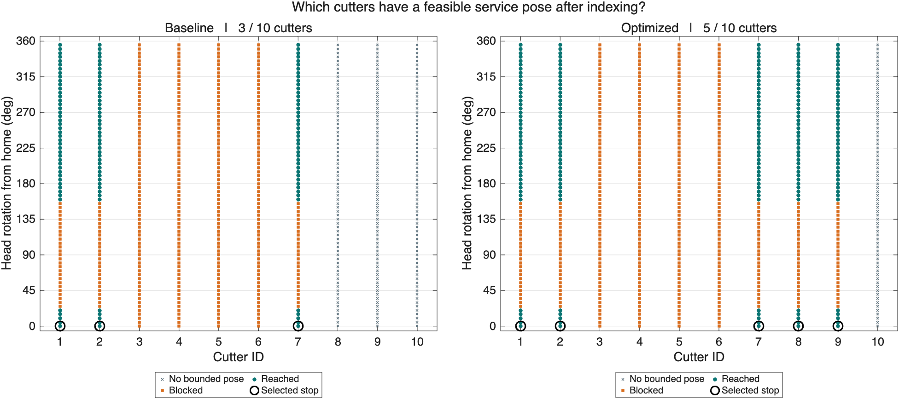

# CutterReach

**Workspace Accessibility Analysis & Design Improvement of a Cutter-Changing Manipulator in a Confined Tunnel Boring Machine Chamber**

CutterReach reproduces the four-revolute, two-prismatic (4R2P) cutter-changing arm described by Yang et al. It asks **whether rotating the cutterhead can bring each cutter into a collision-free service pose**. A cutter counts once if at least one permitted stop satisfies the tool center point (TCP) position, full tool orientation, joint limits and clearance requirements. The denominator is the number of modeled cutters.

The default layout places 10 cutters on one spoke. With stops tested every 5°, the baseline arm reaches **3 of 10 cutters** and the optimized arm reaches **5 of 10**. Mechanical zero happens to serve all the cutters each design can reach, although the same cutter can be blocked at other angles. For example, the optimized arm can reach cutter 08 at 180° but is blocked at 90°. The cutter layout and the relative positions of its supports are course modeling assumptions. [Per-cutter findings and selected stops](results/findings.md)

## Run the study in MATLAB

Set the MATLAB Current Folder to the project root. The project requires MATLAB and Robotics System Toolbox and has been tested in R2026b.

```matlab
study = run_study;                % Check the published baseline, compare designs and export results
demo_study(study);                % Explore the arm, cutters and cutterhead stops in 3D
assertSuccess(runtests('tests')); % Run the automated tests
```

The repository includes the computed results. Run `demo_study` to open them directly. Select a design and a **cutter ID**. With **Automatic stop selection**, the display shows whether the arm can reach the cutter, the selected angle and the number of feasible stops. Select a stop manually to inspect the same cutter at another angle. At mechanical zero (0° rotation), the default cutter spoke has an azimuth of 90° in the base frame.

In the left view, the blue diamond marks the fixed `base_link` and the purple ring marks the selected cutter position. If the search finds no feasible pose, the arm is shown in its stowed pose. The right view rotates independently and lets you switch between **Cutter close-up**, **Installed arm detail**, **Chamber overview** and **Arm assembly**. In the chamber view, the cutterhead, holders, supports and mounting posts rotate together. The working chamber, storage cabin and guide rails stay fixed. The storage cabin measures 1.18 × 1.15 × 3.09 m along X, Y and Z. [Demo screenshot](results/demo_fixed_base.png)

For batch execution, use `matlab -batch "run_study;"`. Each run updates the result files in the configured output directory.

To inspect the editable Robotics System Toolbox model, retrieve a verified joint configuration and compute the corresponding tool transform and Jacobian, run the following commands.

```matlab
load('results/models.mat','optimizedRobot')
load('results/study.mat','study')
i = find(study.optimizedCutters.FeasibleStops > 0, 1);
headRotation_deg = study.optimizedCutters.BestHead_deg(i)
q = study.optimizedCutters.q(i,:);
show(optimizedRobot,q,'Frames','on')
T07 = getTransform(optimizedRobot,q,'frame7');
J = geometricJacobian(optimizedRobot,q,'frame7');
```


Gold identifies the load-bearing side plates, sleeve and gripper jaws. The sliding inner arm is silver-gray, and the copper-colored outer ring is the disc cutter's cutting ring. The chamber view also shows four I-section supports and their mounting posts on the back of the cutterhead. The toolbox model and demo use the same 3D geometry for each design. [Component dimensions and collision assumptions](docs/methods.md)

## Baseline reproduction

The baseline uses the modified Denavit–Hartenberg (MDH) parameters from Table 1, the P–R–R–R–P–R joint sequence and a fixed seventh tool frame. The computed endpoint is **1.30 mm** from the independently reported position. The model reproduces the starting position with the published extension of 1.310 m, which falls below the Table 1 minimum of 1.420 m. All seven joint configurations in Table 2 pass the limit checks, and inverse kinematics recovers a solution within the limits for each reconstructed pose. [Baseline checks, DH table and assumptions](docs/methods.md)

Across 30,000 uniform joint samples within the Table 1 limits, the axial Z coordinate ranges from **−2.904 to 6.039 m**. The text accompanying Figure 10 reports **−0.2 to 4.6 m**. Two explicit configurations within the Table 1 limits also fall outside that published axial range. The study documents this discrepancy and uses the Table 1 model for the design comparison. [Sampled extents](results/paper_workspace_extents.csv) · [Two axial counterexamples](results/paper_axial_examples.csv) · [Paper, pp. 218–221](https://mechanika.ktu.lt/index.php/Mech/article/download/30386/15886)

## Results

| Metric on the default refined grid | Baseline | Optimized |
|---|---:|---:|
| Upper-arm length / telescope stroke | 732 / 650 mm | 900 / 875 mm |
| Cutters with a pose satisfying the target and joint limits at one or more stops | 7/10 | 9/10 |
| Cutters also passing collision checks at one or more stops | 3/10 | 5/10 |
| Mean dexterity for the three cutters both designs reach | 0.2132 | 0.2168 |
| Mean dexterity for all cutters each design reaches | 0.2132 | 0.2026 |
| Cutters reached in the holdout set (nine other radii, stop grid offset by 2.5°) | 4/9 | 5/9 |
| Collision-free fraction of random joint configurations at mechanical zero | 11.38% | 9.92% |

The baseline reaches cutters 01, 02 and 07. The optimized design also reaches cutters 08 (2.95 m radius) and 09 (3.30 m). For cutters 03–06, both designs found poses within the joint limits, but every candidate failed a collision check. For cutter 10 (3.65 m), neither design found a pose within the joint limits at any tested stop. Indexing changes the position of the cutterhead supports relative to the chamber. Each support keeps its position relative to the cutter holders. The results verify static service poses after indexing. Approach, withdrawal and the full cutter replacement sequence require separate verification. [Per-cutter solutions](results/cutters.csv) · [Per-stop results](results/targets.csv) · [Performance metrics](results/performance.csv)



## Project files and parameters

| File | Purpose |
|---|---|
| [run_study.m](run_study.m) | Runs baseline validation, simulation, design comparison and export |
| [+cr/config.m](+cr/config.m) | Defines DH dimensions, joint limits, chamber and supports, targets, tolerances, sampling and candidate designs |
| [+cr/buildRobot.m](+cr/buildRobot.m) and [+cr/fk.m](+cr/fk.m) | Build the `rigidBodyTree` with its carriage, pins, telescoping arm and cutter assembly, and independently compute MDH forward kinematics |
| [+cr/solvePose.m](+cr/solvePose.m) and [+cr/collision.m](+cr/collision.m) | Search a finite grid of redundant joint coordinates, check the full pose and test continuous line-segment capsules for collision |
| [+cr/dexterity.m](+cr/dexterity.m) and [+cr/searchDesign.m](+cr/searchDesign.m) | Compute a Jacobian conditioning metric for attainable motions and search the discrete design grid |
| [tests/TestCutterReach.m](tests/TestCutterReach.m) | Test published checkpoints, the Jacobian against finite differences, extension and angle limits, tool poses, chamber collisions and self-collisions |
| [data/paper_table2.csv](data/paper_table2.csv) | Joint records for seven published cutter IDs, with units in millimeters and degrees in the column names |

Each cutter has a unique `CutterID`, a mounting radius `Radius_m` and an azimuth at mechanical zero `HomeAzimuth_deg`. Multiple cutters can share a radius. Replace `c.cutters` when an actual cutterhead layout is available. To save a modified design grid or chamber experiment in a separate directory, set `c.out` before running the study.

```matlab
c = cr.config;
c.armGrid = [0.70 0.732 0.80 0.85];
c.strokeGrid = [0.60 0.65 0.75 0.85];
c.out = fullfile(c.root,'results_variant');
variant = run_study(c);
```

`run_study` uses `c.baseline` to reproduce the paper and checks its published coordinates. To explore another arm independently, copy `b = c.baseline`, modify parameters such as `b.arm` and `b.limits`, and call `cr.buildRobot`, `cr.fk`, `cr.solvePose` or `cr.evaluate` directly. The kinematic calculations use meters and radians. Tables and figures label their display units.

## Final report, presentation and simulation demo

- **Final report.** Describe the model and acceptance criteria using the methods document. Use the computed summary, design grid and per-cutter holdout results to discuss performance. [Methods and data sources](docs/methods.md) · [Computed findings](results/findings.md) · [All candidate designs](results/design_grid.csv) · [Holdout cutters](results/holdout_cutters.csv)
- **Presentation.** Show the chamber and arm, then the workspace, per-cutter coverage, design comparison and dexterity. [Chamber model](results/model.png) · [Workspace](results/workspace.png) · [Accessibility](results/accessibility.png) · [Design comparison](results/design_comparison.png) · [Dexterity](results/dexterity.png)
- **Simulation demo.** Run `demo_study`. The default selection shows a cutter made accessible by optimization. For cutter 08, keep **Automatic stop selection** and switch between **Baseline** and **Optimized**. Then keep **Optimized** and switch between 90° and 180° to see the outcome change for the same cutter. Each view shows a static assembly pose.
- **Saved MATLAB data.** The study file contains the configuration, primary and holdout target transforms, both designs' sampled joint vectors, tool positions, clearances, failure reasons, per-target solutions and summary metrics. The models file contains both robot trees for use with `show`. [Study data](results/study.mat) · [Robot models](results/models.mat)
