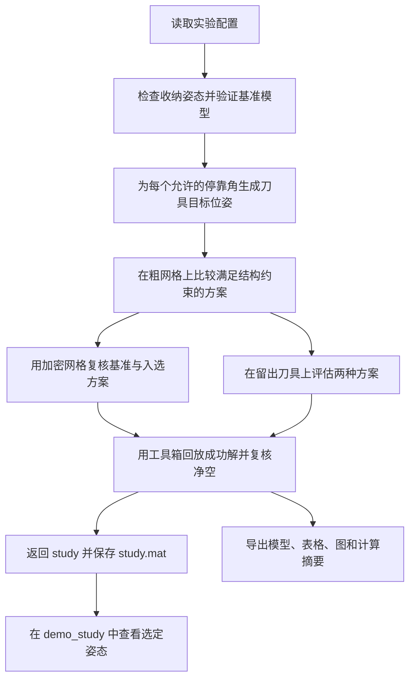
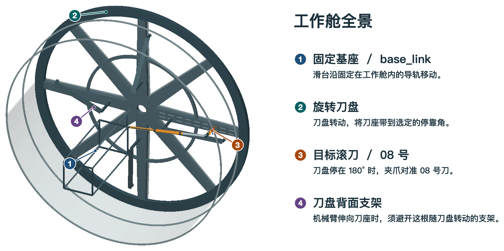
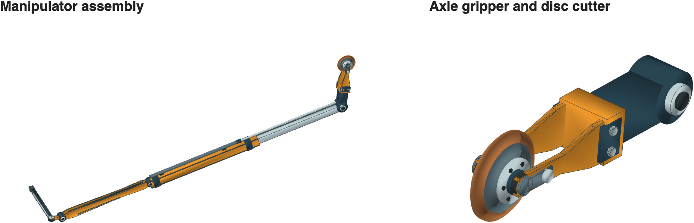
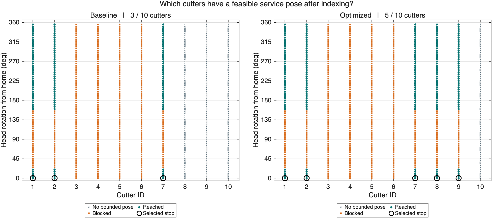

# CutterReach

**受限隧道掘进机工作舱内换刀机械臂的工作空间可达性分析与结构改进**

[English README](../README.md)

隧道掘进机（TBM）依靠刀盘上的滚刀破碎岩石。滚刀磨损后需要更换，人工换刀要进入刀盘背面的狭窄工作舱。用机械臂换刀时，夹爪要以规定方向对准刀座，肩部、肘部和伸缩前臂也都要有空间避开周围结构。

CutterReach 以 Yang 等人提出的四转动、两移动关节（4R2P）机械臂为基准。对每把刀，模型沿整圈每隔 5° 让刀盘停下，检查机械臂能否到达换刀位姿。只要有一个停靠角能让工具中心点（TCP）的位置和夹爪朝向满足误差要求，各关节在限位内，而且整臂通过碰撞检查，该刀就计为可达。每把刀只计一次。

**默认模型的结果。** 在假设的单辐条、10 把刀布局下，大臂由 0.732 m 加长至 0.900 m，前臂伸缩行程由 0.650 m 增至 0.875 m，可达刀具由 **3/10 把增至 5/10 把**，新增 **08 和 09 号刀**。两种设计各自可达的刀具都能在机械零位到达，因此，多出的两把刀来自这两项结构调整。这些计算验证的是刀盘停稳后的静态换刀位姿。机械臂接近刀座、取出旧刀、装入新刀及退出的路径仍需验证。[逐刀计算结果](../results/findings.md) · [结构对比数据](../results/performance.csv)

[运行环境](#matlab-运行环境与入口) · [运行流程](#程序运行流程与代码模块) · [设计取舍](#设计目标与结构取舍) · [机械模型](#机械臂与工作舱模型) · [可达性分析](#刀具可达性分析) · [方案对比](#结构方案对比) · [参数指南](#参数调整指南) · [参数实验](#参数对照实验)

## MATLAB 运行环境与入口

下载并解压仓库的 ZIP 文件，或在终端运行 `git clone https://github.com/Errorsteved/CutterReach.git`。将 MATLAB 的 **Current Folder** 设为包含 `run_study.m` 的目录，MATLAB 就能从 `+cr` 包中找到 `cr.fk` 等函数。项目需要 MATLAB 和 Robotics System Toolbox，已在 R2026b 上验证。在命令窗口输入 `which rigidBodyTree` 应能看到该工具箱的文件路径。运行 `demo_study` 即可打开仓库中已保存的仿真结果。

```matlab
study = run_study;                % 复核论文基准、比较设计并导出结果
demo_study(study);                % 在三维界面中查看机械臂、刀具与刀盘停靠角
assertSuccess(runtests('tests')); % 运行自动化测试，若有测试未通过则报错
```

选择 **Automatic stop selection**（自动选择停靠角）可查看所选刀具是否可达、程序选取的角度和可行停靠角的数量。界面中的 0° 表示刀盘处于机械零位，此时装刀辐条在机械臂基坐标系中的方位角为 90°。

左图中的蓝色菱形标记固定基座 `base_link`。右图可以独立旋转，并可切换 **Cutter close-up**（刀头特写）、**Installed arm detail**（安装局部）、**Chamber overview**（工作舱全景）和 **Arm assembly**（整臂装配）。收纳舱沿 X、Y、Z 方向的尺寸分别为 1.18、1.15、3.09 m。[演示截图](../results/demo_fixed_base.png)

在终端可使用 `matlab -batch "run_study;"` 批量运行。每次运行都会更新所配置输出目录中的结果文件。

## 程序运行流程与代码模块

`run_study` 负责数值计算，上面的示例将它返回的 MATLAB 结构体命名为 `study`。主实验与留出集使用不同的刀具目标，但都调用同一套逆解和碰撞检查代码。`demo_study(study)` 读取计算得到的关节构型并绘图。自动化测试由 `runtests('tests')` 单独运行。



| 阶段 | 主要 MATLAB 文件 | 输入与产出 |
|---|---|---|
| 配置实验 | [run_study.m](../run_study.m)、[config.m](../+cr/config.m) | 读取机械臂尺寸、工作舱几何、刀号、允许的停靠角、容差和候选设计网格。调用 `run_study(c)` 可传入一组自定义配置。 |
| 搭建与核对模型 | [buildRobot.m](../+cr/buildRobot.m)、[fk.m](../+cr/fk.m)、[validateBaseline.m](../+cr/validateBaseline.m)、[workspace.m](../+cr/workspace.m) | 建立工具箱机械臂，用独立的正运动学实现核对位姿，检查论文控制点并回放[表 2 关节记录](../data/paper_table2.csv)。工作空间计算把随机关节构型映射为刀盘零位下的 TCP 点云，两种设计使用同一组归一化样本。 |
| 求一个刀号在一个停靠角的解 | [indexedTargets.m](../+cr/indexedTargets.m)、[evaluate.m](../+cr/evaluate.m)、[solvePose.m](../+cr/solvePose.m)、[collision.m](../+cr/collision.m) | 从刀座安装位置和刀盘转角算出目标位姿，把盘上障碍物转到同一角度，再检查候选关节构型。每个“刀号 × 停靠角”得到一行结果，记录求解状态，以及有解时选出的关节构型。 |
| 比较结构方案 | [structure.m](../+cr/structure.m)、[summarizeCutters.m](../+cr/summarizeCutters.m)、[searchDesign.m](../+cr/searchDesign.m) | 对每组大臂长度与伸缩行程检查最大伸长和收纳约束，再按刀号统计可达数量。优先选择可达刀具最多的方案，其次比较全部刀具的平均灵巧度（失败记零），仍并列时选大臂长度与行程之和较小者。 |
| 复核与保存 | [verifyWitnesses.m](../+cr/verifyWitnesses.m)、[exportFigures.m](../+cr/exportFigures.m)、[writeFindings.m](../+cr/writeFindings.m) | 用工具箱复算加密集和留出集的成功位姿，并复核净空。主程序将研究结果保存到 `study.mat`，将两棵机械臂刚体树保存到 `models.mat`，并将逐角、逐刀及设计指标写入 CSV。导出函数生成图和计算摘要。 |
| 查看与测试 | [demo_study.m](../demo_study.m)、[TestCutterReach.m](../tests/TestCutterReach.m) | 演示读取传入的 `study`。无参数时读取默认结果文件，若该文件或其中的逐刀结果缺失，则重新计算默认研究。独立测试覆盖运动学、刀盘分度、碰撞和界面显示。 |

## 设计目标与结构取舍

机械臂向刀盘外圈伸得越远，越有机会触及外圈滚刀，但它还要避开刀盘背面的支架，并能折叠回收纳舱。为研究这项取舍，项目固定论文中的关节布置、基座安装位置和夹爪偏移，只改变两个结构尺寸。大臂长度决定肘部的位置，也影响折叠时占用的空间。伸缩行程决定前臂能在相同的 1.420 m 收缩长度基础上再伸出多远。分别改变这两个量，再考察二者组合，可以看出哪些结构变化实际增加了可服务的刀具数。[模型尺寸](../+cr/config.m) · [收纳与伸长约束](../+cr/structure.m)

默认网格含四种大臂长度和五种伸缩行程，可以在相同的刀具布置和工作舱条件下逐组计算。20 组组合中有 16 组通过结构检查。其余四组的行程均为 0.950 m，完全伸长时达到 2.370 m，超过 2.320 m 的安装上限。在选型网格上，基准方案可达 3/10 把刀。只把大臂加长到 0.900 m，或只把行程增加到 0.875 m，均可达 4/10 把。两项改动同时采用时可达 5/10 把。这一选型结论适用于所测试的参数网格和假设的安装条件。[20 组候选设计的计算结果](../results/design_grid.csv)

## 机械臂与工作舱模型

装配模型由 MATLAB 根据尺寸和关节定义生成。`+cr` 包负责构建实体外形与碰撞几何，`data/paper_table2.csv` 提供用于复核的论文关节记录，`run_study.m` 将计算得到的表格、图片和模型保存到 `results/`。



基座周围的长方体框架是收纳舱。刀盘转到另一停靠角时，收纳舱和导轨保持固定，刀座和背面支架随刀盘一起转动。图中的刀具布局和支架位置均为课程建模假设。

刀盘转动后，夹爪仍须与刀座对准。模型用三个坐标系描述工作舱、刀盘和机械臂末端的相对运动。机械臂和工作舱以固定基坐标系定位。刀盘绕自己的轴线旋转，该轴线在基座 XY 平面上的投影为 (0.560, 0) m。工具坐标系 `frame7` 跟随夹爪运动，原点位于滚刀质心。判断能否换刀时，程序把目标刀位和机械臂的实际末端位姿都换算到基坐标系下进行比较。

| 关节变量 | 对应的实际运动 | 基准限位 |
|---|---|---|
| `q(1) = d1` | 滑台沿轴向导轨向刀盘伸出 | 0 至 3.000 m |
| `q(2) = theta2` | 回转座带动整臂绕基座回转轴转动 | 0° 至 360° |
| `q(3) = theta3` | 大臂绕肩关节俯仰 | −125° 至 75° |
| `q(4) = theta4` | 前臂绕肘关节俯仰 | −150° 至 65° |
| `q(5) = d5` | 前臂沿自身轴线伸缩 | 1.420 至 2.070 m，取**绝对长度** |
| `q(6) = theta6` | 腕关节调整工具俯仰角 | −180° 至 0° |

在 MATLAB 中，这六个量按表中顺序组成行向量，平移量用米，转角用弧度。第七坐标系给出 0.460 m 的固定工具偏移。`cr.mdh` 定义相邻坐标系的关系，`cr.buildRobot` 用工具箱组装刚体树，再把滑台、侧板、套筒和夹爪挂到各自运动的坐标系上。`cr.fk` 独立连乘七个变换求正运动学。在大批量搜索时，`cr.geometry` 一次处理多组关节值，求出构成五段连杆胶囊的六个端点。程序先用这些包络检查整臂，再用工具箱模型复核选出的可行姿态。[MDH 参数](../+cr/mdh.m) · [机械臂装配](../+cr/buildRobot.m) · [批量几何计算](../+cr/geometry.m)

刀具目录的每一行定义一个刀座在刀盘机械零位时的安装位置。默认目标 TCP 距刀盘背面 0.160 m，因此其轴向坐标为 4.000 − 0.160 = 3.840 m。刀座的方向由径向、切向和轴向共同确定。这三根轴规定了 TCP 到达目标位置时，夹爪应如何与刀轴对准。外圈刀座的倾角从半径 2.25 m 处的 0° 逐渐增至 3.50 m 处的 12°。刀盘分度时，刀座和固定在盘上的支架使用同一个刚体变换，二者在盘上的间距始终相同。更换停靠角会改变它们相对固定工作舱和机械臂的位置，原先通畅的刀位可能受阻，受阻的刀位也可能获得可行解。[目标坐标系](../+cr/targets.m) · [分度后的刀位](../+cr/indexedTargets.m) · [分度后的障碍物](../+cr/indexedEnvironment.m)

以下示例从优化方案中取出一组已验证的关节构型，在 Robotics System Toolbox 中显示可编辑的三维模型，并计算对应的末端变换和几何雅可比矩阵。

```matlab
load('results/models.mat','optimizedRobot')
load('results/study.mat','study')
i = find(study.optimizedCutters.FeasibleStops > 0, 1);
headRotation_deg = study.optimizedCutters.BestHead_deg(i)
q = study.optimizedCutters.q(i,:);
show(optimizedRobot,q,'Frames','on')
T07 = getTransform(optimizedRobot,q,'frame7');
J = geometricJacobian(optimizedRobot,q,'frame7');
```



金色部件包括承载侧板、套筒和夹爪，银灰色部件是可伸缩的内臂，铜色外环是盘形滚刀的刀圈。工作舱视图还显示了刀盘背面的四根工字形支架及其安装立座。每种设计在工具箱模型和演示窗口中使用同一套三维几何。[部件尺寸与碰撞建模假设](methods.md)

## 论文基准验证

基准模型采用论文表 1 的修正 Denavit–Hartenberg（MDH）参数。六个关节依次为 P–R–R–R–P–R，第七坐标系固定在工具上。模型算出的终点与论文独立报告的终点位置相差 **1.30 mm**。代入论文给出的 1.310 m 伸缩长度可以复现起点，但该长度低于表 1 的 1.420 m 下限。表 2 中的七组关节构型均通过限位检查，按各组关节量重建的末端位姿也均能求得满足限位的逆解。[基准核对、DH 参数表与假设](methods.md)

在表 1 的关节范围内均匀采样 30,000 次，得到的轴向 Z 范围为 **−2.904 至 6.039 m**。论文图 10 的配套文字报告为 **−0.2 至 4.6 m**。项目还给出了两组满足表 1 限位、但轴向位置超出论文所报范围的具体构型。后续结构对比统一采用表 1 的模型。[采样范围](../results/paper_workspace_extents.csv) · [两组轴向反例](../results/paper_axial_examples.csv) · [论文原文，第 218–221 页](https://mechanika.ktu.lt/index.php/Mech/article/download/30386/15886)

## 刀具可达性分析

选型、加密复核和留出集都使用相同的判定步骤。默认选型时每 15° 检查一次，加密复核时每 5° 检查一次，留出集换用其他半径，并将停靠角网格偏移 2.5°。每次评估都逐个处理“刀号 × 停靠角”组合。

1. **求一把刀在一个停靠角的逆解。** 目标的位置和姿态给出基座回转角与合成俯仰角。同一个末端位姿可能对应多种肘部位置，其中有些会碰到支架，有些可以避开。程序在固定网格上采样肩关节角和前臂伸缩长度，枚举三角方程的两个分支，恢复其余关节量并用正运动学复算，使不同方案的候选解可重复比较。`nPose` 是同时通过关节限位、位置误差和姿态误差检查的候选数。[逆运动学求解器](../+cr/solvePose.m)
2. **检查整条机械臂。** 用带半径的线段（胶囊）包住每段连杆，即使连杆两端都绕开了障碍物，线段间的距离检查仍能发现中段干涉。程序依次检查工作舱与收纳舱边界、当前角度下的支架和立座，以及非相邻连杆。估算的净空取决于所用包络半径。最小表面净空必须严格大于预留值。`nFree` 记录通过的构型数。每个被淘汰的碰撞候选按最小净空归入 `nWall`（舱体边界）、`nBrace`（支架及立座）或 `nSelf`（自碰撞）。成功解的 `gap = 0.001` m 表示扣除预留净空后**还剩 1 mm**。[碰撞检查](../+cr/collision.m)
3. **为每把刀选停靠角。** 在静态换刀位姿评估中，一把刀有一个可用停靠角就足够。按刀号只计一次，加密角度网格时覆盖率的分母仍保持一致。只要有一个角度满足 `nFree > 0`，该刀即计为可达。程序保留灵巧度最高的可行构型。灵巧度取归一化雅可比矩阵的 $\eta=\sigma_4/\sigma_1$。该机构虽有六个驱动关节，但在一般构型下只有四个独立的瞬时运动方向，$\eta$ 越大，这四个方向上的运动条件越好。不同停靠角灵巧度并列时，优先选择从零位转动距离最短的角度。[逐刀汇总](../+cr/summarizeCutters.m) · [灵巧度计算](../+cr/dexterity.m)

对于 08 号刀，优化方案在 90° 时有 347 组候选姿态满足关节限位和位姿要求，但全部未通过碰撞检查，其中 18 组受支架限制，329 组发生自碰撞。在 180° 时，347 组候选中有 308 组通过。整圈 72 个停靠角中，08 号刀在 45 个角度可达。[逐角记录](../results/targets.csv) · [逐刀汇总](../results/cutters.csv)

```matlab
saved = load('results/study.mat','study');
t = saved.study.optimizedTargets;
rows = t.CutterID == 8 & ismember(t.Head_deg,[90 180]);
disp(t(rows,{'Head_deg','Azimuth_deg','nPose','nFree','nWall','nBrace','nSelf','status'}))
```

| 计算结果 | 排查依据 |
|---|---|
| 某把刀在所有停靠角都出现 `nPose = 0` | 核对刀具半径、刀座倾角、TCP 偏距和关节限位，再对同一批目标加密逆解网格。如果外圈刀仍无解，可在设计网格中单独改变大臂长度或伸缩行程。 |
| `nPose > 0`，但 `nFree = 0` | 比较不同角度下的三类碰撞计数。在工作舱全景中观察舱壁和支架，在整臂视图中观察可能自碰撞的连杆。即使固定在盘上的支架始终紧邻同一刀座，换一个停靠角仍可能改变机械臂的构型。 |
| 只在选型网格上看到提升 | 先看加密复核中相同刀号的结果，再看独立留出集。比较双方都能到达的刀具时用 `MeanEtaCommon`。如果新增了外圈刀，`MeanEtaReached` 所平均的刀具集合也随之改变。 |

## 结构方案对比

| 默认加密网格下的指标 | 基准方案（Baseline） | 优化方案（Optimized） |
|---|---:|---:|
| 大臂长度 / 伸缩行程 | 732 / 650 mm | 900 / 875 mm |
| 至少一个停靠角满足目标位姿和关节限位的刀具数 | 7/10 | 9/10 |
| 至少一个停靠角还同时通过碰撞检查的刀具数 | 3/10 | 5/10 |
| 两种方案均可达的 3 把刀上的平均灵巧度 | 0.2132 | 0.2168 |
| 各方案自身可达刀具上的平均灵巧度 | 0.2132 | 0.2026 |
| 留出集可达刀具数（另选 9 个半径，停靠角网格偏移 2.5°） | 4/9 | 5/9 |
| 刀盘处于机械零位时，随机关节构型中的无碰撞比例 | 11.38% | 9.92% |

基准方案可以到达 01、02、07 号刀。优化后新增 08 号刀（半径 2.95 m）和 09 号刀（半径 3.30 m）。对于 03–06 号刀，两种方案都找到了满足位姿和关节限位的候选构型，但所有候选均在碰撞检查中被淘汰。对于 10 号刀（半径 3.65 m），两种方案在所有测试角度均未找到满足关节限位的目标位姿解。[逐刀解](../results/cutters.csv) · [逐停靠角结果](../results/targets.csv) · [性能指标](../results/performance.csv)



## 参数调整指南

每个实验都从 `c = cr.config` 开始。配置中的距离用米，刀盘停靠角和刀座方位角用**度**，机器人转动关节的角度及 `rotationTol` 用**弧度**。同一行归在 `c.env` 或 `c.baseline` 下的字段共用该前缀。例如，工作舱半径的完整字段名是 `c.env.radius`。[默认配置](../+cr/config.m)

### 机械臂与安装几何

| 字段 | 默认值 | 调整方法与结果解读 |
|---|---|---|
| `c.armGrid`、`c.strokeGrid` | 大臂长度 [0.650, 0.732, 0.820, 0.900] m，伸缩行程 [0.500, 0.650, 0.800, 0.875, 0.950] m | 每个长度都与每种行程组合，程序自动补入基准值。单独研究大臂长度时，把行程固定为基准的 0.650 m。单独研究行程时，把大臂长度固定为 0.732 m。 |
| `c.maxExtended`、`c.maxStrokeRatio` | 最大伸长长度 2.32 m，最大行程与收缩长度之比 0.65 | 最大绝对长度等于收缩长度加行程，行程还受比例上限约束。例如行程 0.950 m 对应 1.420 + 0.950 = 2.370 m，超过 2.32 m。可在 `design_grid.csv` 的 `Structure` 列查看淘汰原因。候选结构还须能按规定姿态折叠进收纳舱。 |
| `c.baseline.baseOffset`、`shoulderOffset`、`arm`、`tool`、`limits` | 基座偏移、肩部偏移、大臂长度和工具偏移分别为 0.560、0.100、0.732、0.460 m。六组关节限位见上文关节表。 | 单独研究几何或限位时，先复制 `b = c.baseline`。例如 `b.limits(4,:) = deg2rad([-140 60])` 会改变肘部角限位。用 `[ok,reason] = cr.structure(b,c)` 检查能否收纳，再用 `cr.evaluate` 检查目标。完整入口 `run_study` 会用 `c.baseline` 核对论文坐标与关节记录。 |
| `c.env.center`、`radius`、`headZ`、`depths`、`cabinXY`、`cabinSize` | 舱轴 XY [0.560, 0]，工作舱半径 4.315，刀盘背面 Z 4.000，两段舱深 [1.425, 0.995]，收纳舱中心 XY [0.330, 0]，收纳舱尺寸 XYZ [1.180, 1.150, 3.090]，均为米 | 用实测安装尺寸替换。配置中 `gateZ = headZ - sum(depths)`，`rearZ = gateZ - cabinSize(3)`。舱口位置、后壁位置和支架端点在生成配置时计算。修改上游尺寸时，可在 `config.m` 中相应计算之前修改，或同步更新配置副本里的派生字段。 |
| `c.env.strutA`、`strutB`、`strutRadius`、`postRadius`、`linkRadius` | 零位有四对支架端点，支架半径 0.105 m，立座半径 0.075 m，五段连杆包络半径依次为 [0.030, 0.038, 0.055, 0.080, 0.095] m | 两个端点矩阵的对应行是一根斜支架两端在机械零位的 XYZ 基坐标。移动支架时应更新两个端点，程序会按各停靠角旋转它们。连杆半径同时影响碰撞包络和部分显示零件的尺寸。 |

### 刀具布置、判定条件与搜索精度

| 字段 | 默认值 | 调整方法与结果解读 |
|---|---|---|
| `c.cutters`、`c.checkCutters`、`c.env.spokeZero_deg` | 主实验半径 0.50–3.65 m，留出集半径 0.675–3.475 m，间距均为 0.35 m，默认安装方位 90° | 每行填唯一正整数刀号 `CutterID`、非负半径 `Radius_m` 与安装方位 `HomeAzimuth_deg`。不同方位允许相同半径。参考辐条角用于生成默认目录和显示辐条。执行 `cr.config` 后，如要移动刀座，应直接更新刀具目录中的方位列。 |
| `c.indexAngles`、`c.fineAngles`、`c.checkAngles` | 选型 0:15:345°、加密复核 0:5:355°、留出集 2.5:5:357.5° | 填写相对刀盘机械零位允许转过的角度。加密角度列表必须包含所有选型角。程序将角度按 360° 取模并去重。若物理上仅允许转半圈，留出集也应使用这个范围。 |
| `c.standoff` 与 `cr.targets` 中的刀座倾角 | TCP 与刀盘背面的轴向间距 0.160 m，径向倾角从 0° 变至 12° | 增大间距会使目标沿 −Z 向舱内移动。倾角由 `+cr/targets.m` 中随半径变化的公式给出。有实测刀座姿态时可在该处修改。 |
| `c.positionTol`、`c.rotationTol`、`c.env.clearance` | 0.004 m、`deg2rad(2)`、0.008 m | 位姿误差允许等于阈值，表面净空必须严格大于预留值。容差用于验收指定目标位姿的候选解，求解器不会在整个容差带内另行搜索。比较两种设计时应使用相同阈值。 |
| `c.ikGrid`、`c.fineGrid` | [41 17]、[81 33] | 两个数字依次为肩关节俯仰角、伸缩段绝对长度的采样数。例如先设 `c.ikGrid = [61 25]`，再设 `c.fineGrid = 2*c.ikGrid - 1`，加密网格就会包含原采样点。加密可能发现漏掉的解，也会增加运行时间。 |
| `c.nWorkspace`、`c.seed`、`c.Lref`、`c.out` | 30,000 个样本、随机种子 30386、参考长度 1 m、输出目录 `results` | 样本数和随机种子控制工作空间点云，按刀号求解使用确定性网格。`Lref` 用于归一化灵巧度，比较不同设计时应保持一致。不同实验可用 `c.out` 指定各自的结果目录。 |

## 参数对照实验

### 固定伸缩行程下的大臂长度对比

保留论文基准用于复核，把伸缩行程固定为基准值，仅改变大臂长度。`grid` 表显示所有候选在选型网格上的结果，`summary` 表可查看胜出方案在加密复核和留出集上是否也有改善。

```matlab
c = cr.config;
c.armGrid = [0.732 0.820 0.900];
c.strokeGrid = 0.650;
c.out = fullfile(c.root,'results_arm_only');
variant = run_study(c);
disp(variant.grid(:,{'Arm_m','Stroke_m','Structure','Reached','MeanEtaAll','Selected'}))
disp(variant.summary(:,{'Set','Design','Reached','Cutters','Rate','MeanEtaCommon'}))
demo_study(variant);
```

使用默认刀具与净空时，三种长度在选型网格上分别可达 3、4、4 把刀。0.900 m 方案凭灵巧度胜出。加密复核从基准的 3/10 提高到 4/10，但留出集上两者都是 4/9。上文主结果表中的 5/10 同时使用了 0.875 m 的较长行程。将 `variant` 传给演示程序可以查看新实验，无参数的 `demo_study` 会读取默认结果。

### 半圈分度条件下的刀具布置

下面把两把刀安装在相同半径、不同辐条上，并将转角限制为半圈。先复用**已经选出的机械臂结构**，单独观察新刀具布置和停靠角带来的影响。

```matlab
c = cr.config;
c.cutters = table([21;22],[2.95;2.95],[90;135], ...
    'VariableNames',{'CutterID','Radius_m','HomeAzimuth_deg'});
c.indexAngles = 0:15:180;
c.fineAngles = 0:5:180;
c.checkAngles = 2.5:5:177.5;
saved = load('results/study.mat','study');
g = cr.indexedTargets(c,c.cutters,c.fineAngles);
t = cr.evaluate(saved.study.optimized,g,c,c.fineGrid);
perCutter = cr.summarizeCutters(t);
disp(perCutter(:,{'CutterID','StopsTested','FeasibleStops','BestHead_deg','status'}))
```

本例每把刀测试 37 个停靠角。如需针对新场景重新选择结构，设置 `c.out = fullfile(c.root,'results_half_turn')`，再运行 `variant = run_study(c)`。`c.checkCutters` 此时仍是默认留出集，有独立的实测验证刀具时可一并替换。

### 可达性对预留净空的敏感性

固定机械臂、刀具、停靠角和逆解网格，以两个净空要求重复检查相同目标。`ExtraGap_mm` 表示满足该次预留值后，选中姿态还剩多少毫米的净空。

```matlab
c = cr.config;
saved = load('results/study.mat','study');
b = saved.study.optimized;
g = cr.indexedTargets(c,c.cutters(c.cutters.CutterID==8,:),[90 180]);
for allowance_mm = [8 12]
    c.env.clearance = allowance_mm/1000;
    t = cr.evaluate(b,g,c,c.fineGrid);
    disp(table(repmat(allowance_mm,height(t),1),t.Head_deg,t.nPose,t.nFree,1000*t.gap, ...
        'VariableNames',{'Allowance_mm','Head_deg','PoseCandidates','ClearCandidates','ExtraGap_mm'}))
end
```

在 180° 处，把预留净空从 8 mm 提至 12 mm，可行候选数从 308 降至 307。程序可能改选另一组关节值，因此应同时观察候选数和选中姿态的剩余净空。在 90° 处，两次都有 347 个位姿候选，均未通过碰撞检查。如果修改会影响整个舱体或收纳姿态，可运行完整研究，重新执行结构检查并比较两种设计。
